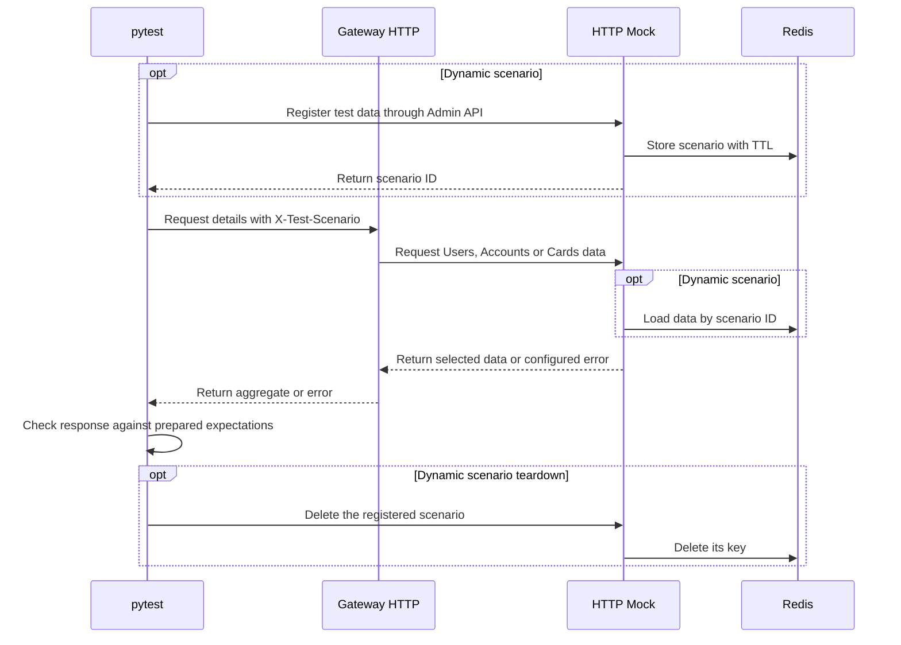
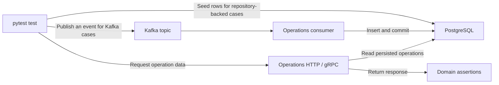

# Isolation API Tests

**English** · [Русский](README.ru.md)

[](https://github.com/Barbaron86/isolation-api-tests/actions/workflows/isolation-tests.yml)


API test automation for a sample banking system. The suites exercise **Gateway**
with controlled Users, Accounts and Cards dependencies, and **Operations** with
real PostgreSQL and Kafka. Both services run locally in Docker Compose. pytest
runs on the host and records test steps, assertions and logs in Allure.

[Allure Report](https://barbaron86.github.io/isolation-api-tests/) ·
[GitHub Actions](https://github.com/Barbaron86/isolation-api-tests/actions/workflows/isolation-tests.yml)

## 📑 Contents

[Quick Start](#-quick-start) · [Tech Stack](#-tech-stack) ·
[Test Scenarios](#-test-scenarios) · [Architecture](#-architecture) ·
[Project Structure](#-project-structure) · [Running Tests](#-running-tests) ·
[Reports](#-reports) · [CI/CD](#-cicd)

## 🚀 Quick Start

Install **Python 3.12** and start **Docker with Compose v2** in Linux container
mode. Clone the repository and run the commands from its root.

```shell
git clone https://github.com/Barbaron86/isolation-api-tests.git
cd isolation-api-tests
```

<details>
<summary>Create a Python 3.12 virtual environment</summary>

Windows PowerShell:

```powershell
py -3.12 -m venv .venv
.\.venv\Scripts\Activate.ps1
```

Linux or macOS:

```bash
python3.12 -m venv .venv
source .venv/bin/activate
```

</details>

```shell
python -m pip install -r requirements.txt
docker build -t base-service .
docker compose -f docker-compose.yaml up -d
python scripts/wait_for_stand.py --compose-file docker-compose.yaml --timeout 180
python -m pytest -m regression
```

The repository includes local stand settings in `.env` and test client settings
in `tests/.env`. The readiness script checks PostgreSQL initialization and
migrations, Redis, the Kafka broker and consumer, and HTTP/gRPC connectivity.
Stop the local stand with `docker compose -f docker-compose.yaml down`.

| Component | Local address |
| --- | --- |
| Gateway | HTTP `localhost:8001` · gRPC `localhost:9001` |
| Operations | HTTP `localhost:8002` · gRPC `localhost:9002` |
| Mock Service | [HTTP Swagger UI](http://127.0.0.1:8003/docs) · gRPC `localhost:9003` |
| Stand tools | [Kafka UI](http://localhost:8081) · [pgAdmin](http://localhost:5050) |

## 🧰 Tech Stack

| Tool | Role in the project |
| --- | --- |
| **Python 3.12** | Language for the services, mocks and test framework. |
| **pytest / pytest-xdist** | Fixtures, parametrization, test selection by markers and optional parallel execution. |
| **HTTPX** | HTTP clients for tests and downstream service calls. |
| **gRPC / Protocol Buffers** | Typed RPC contracts, generated stubs and request metadata. |
| **Pydantic / Pydantic Settings** | Typed request and response models, API field aliases and settings from environment variables. |
| **Faker / UUID4** | Synthetic test data and identifiers for independent test resources. |
| **FastAPI / Uvicorn** | HTTP APIs for the applications and mock service. |
| **PostgreSQL / SQLAlchemy / Alembic** | Operations persistence, test data setup and cleanup, and database migrations. |
| **Kafka / confluent-kafka / aiokafka** | Event broker, test producer and Operations consumer. |
| **Redis / redis-py** | Shared, TTL-backed storage for dynamic HTTP mock scenarios. |
| **Python logging** | HTTP/gRPC calls, assertions and cleanup diagnostics. |
| **Allure / allure-pytest** | Test steps, logs, environment metadata and report history. |
| **Docker Compose** | Local and CI test stands with readiness checks. |
| **GitHub Actions / GitHub Pages** | Separate unit and API jobs and publication of the Allure report. |

Python dependencies are pinned in [requirements.txt](requirements.txt). Container
images and service settings are declared in the [local Compose file](docker-compose.yaml)
and the [CI Compose file](docker-compose.ci.yaml).

## 🧪 Test Scenarios

| Suite | Data setup | What the tests verify |
| --- | --- | --- |
| Gateway HTTP and gRPC | Built-in mock scenarios | User/account aggregates, exact accounts and cards, empty collections, missing entities, and propagation of dependency errors. |
| Dynamic Gateway HTTP | Test-owned records registered through the Mock Admin API | Aggregation, different snapshots for the same entity ID, isolation of a dependency failure, a missing account with available cards, and `404` after scenario deletion. |
| Operations HTTP and gRPC | Rows inserted through the test repository | Lookup by ID, missing operations, user/card/account filters, combined card and account filters, and exact result membership. |
| Operations through Kafka | Test events published to the Operations topic | Processing of `IN_PROGRESS` and `COMPLETED` purchases, several events for one user, and filtering after all competing events have been processed. |
| Unit tests | Controlled dependencies in the pytest process | Cleanup ordering and failure handling, repository timeout budgets, scenario resolution and storage, and Redis serialization, TTL configuration and error handling. |

## 🏗 Architecture

The application diagrams show the service boundaries. On the test stand,
Gateway's downstream clients connect directly to the matching HTTP or gRPC mock
routes. Both Operations suites cover direct PostgreSQL setup and Kafka-driven
processing.


<details>
<summary>Gateway service architecture</summary>


</details>

<details>
<summary>Operations service architecture</summary>


</details>

### Test Execution Flow

pytest fixtures prepare test data and provide typed clients. Successful HTTP
calls check the expected status before parsing the response with Pydantic. Negative
cases use raw responses to check the status and error details. gRPC calls use
generated protobuf stubs. Domain assertions compare responses with expectations
built from the prepared data.

#### Gateway and its dependencies

Built-in scenarios are selected through `X-Test-Scenario` in HTTP or
`x-test-scenario` metadata in gRPC. For dynamic HTTP tests, the same header carries
the ID returned by the Admin API. Each dependency route selects the scenario
and uses the requested entity ID to find or filter the data.



The same-account test registers two scenarios with the same account ID, different
balances and different cards. It checks that both downstream responses come
from the requested scenario. [Gateway test](tests/suites/http/test_gateway.py#L405)

<details>
<summary>Try the HTTP Mock Admin API</summary>

Open [Swagger UI](http://127.0.0.1:8003/docs). Send `POST /__admin/scenarios` with
the following synthetic card as the request body.

```json
{
  "card": {
    "id": "ba8bb30a-5ee7-4c4d-a89d-ad7fe7d1b389",
    "pin": "1234",
    "cvv": "123",
    "type": "VIRTUAL",
    "status": "ACTIVE",
    "accountId": "df36b93c-84c2-4b92-b6db-df59f18c1684",
    "cardNumber": "4111111111111111",
    "cardHolder": "TEST CARD",
    "expiryDate": "2030-12-31",
    "paymentSystem": "VISA"
  }
}
```

1. Copy `id` from the `201 Created` response. It has the form `dynamic-<uuid>`.
2. Inspect the scenario with `GET /__admin/scenarios/{id}`, or send
   `GET /api/v1/cards/{card_id}` with `card.id` in the path and the scenario ID
   in the `X-Test-Scenario` header.
3. Delete it with `DELETE /__admin/scenarios/{id}`. A successful delete returns
   `204 No Content`, including a repeated delete of the same ID.

The Admin API also accepts `{"account": {...}, "cards": [...]}` and a `gateway`
object with `users`, `accounts`, `cards` and `unavailable` lists. Entity IDs
must be unique within their list. To configure `503`, put one of
`users.get_user`, `accounts.get_accounts`, `accounts.get_account` or
`cards.get_cards` in `unavailable`.

In Compose, three HTTP mock workers share Redis. Scenarios expire one hour
after registration and survive an HTTP mock restart while Redis keeps its
data. The Compose Redis instance is ephemeral. Dynamic mode without
`MOCK_REDIS_URL` uses a single worker and in-memory storage. An unknown or
expired ID returns `404`. A Redis connection error or timeout on a dynamic
request returns `503`.

</details>

#### Operations with PostgreSQL or Kafka



For database-backed cases, the test writes rows before making the API call.
For Kafka cases, the producer confirms broker delivery and the test then waits
for the expected operation count through the public API. A broker acknowledgment
only confirms delivery to Kafka. The separate API read observes the consumer's
persisted result. After the expected count is reached, assertions check the
operation fields, membership and unique IDs.

The card-filter test publishes two events for the same user, waits until both
operations are visible, then filters by card and checks that only the matching
operation is returned. [Operations test](tests/suites/http/test_operations.py#L288)

Cleanup removes test-owned rows by primary key. For Kafka events, it records
existing IDs before publication and finds new IDs for the test's
`(user_id, card_id, account_id)` combination. Late writes outside the cleanup
deadline may require manual investigation.

## 📁 Project Structure

```text
services/           Gateway and Operations, plus downstream client contracts
libs/               Shared application clients, context and configuration
protos/             Protobuf contracts and generated gRPC code
tests/
  suites/           HTTP and gRPC API suites
  unit/             Cleanup, mock scenario and Redis unit tests
  clients/          HTTP, gRPC, Kafka and PostgreSQL test access
  fixtures/         Test setup and resource cleanup
  schema/           Pydantic test models
  assertions/       Protocol and domain assertions
  mock/             HTTP and gRPC mocks and scenario data
scripts/            Stand readiness, diagnostics and Allure metadata
```

## ▶️ Running Tests

Run API commands against a ready stand. The unit suite runs without Docker
or live services.

| Scope | Command |
| --- | --- |
| Unit tests | `python -m pytest tests/unit --noconftest -o addopts= -q` |
| Full API regression | `python -m pytest -m regression` |
| Gateway over HTTP and gRPC | `python -m pytest -m gateway` |
| Dynamic HTTP Gateway | `python -m pytest tests/suites/http/test_gateway.py::TestDynamicGatewayHTTP` |
| Operations over HTTP and gRPC | `python -m pytest -m operations` |
| Kafka-backed Operations | `python -m pytest -m operations -k operation_events` |

<details>
<summary>Parallel execution, debugging and timeout settings</summary>

The default run is sequential. To run the API regression with two pytest workers,
prepare the stand once and run:

```shell
python -m pytest -m regression -n 2 -o addopts= -q --alluredir=./allure-results-parallel
```

Use separate user IDs across independent Operations tests because user-only reads
can see every operation for that user.

To inspect Operations data after a setup or test failure, add
`--keep-test-data-on-failure`. The **Cleanup skipped** attachment lists the
registered actions and test ID. Use PostgreSQL to confirm which rows exist
and remove retained rows after debugging. Dynamic Gateway scenarios have their
own teardown.

| Setting | Default | Purpose |
| --- | --- | --- |
| `KAFKA_DELIVERY_TIMEOUT` | `10s` | Confirm delivery to the broker. |
| `OPERATIONS_PROCESSING_TIMEOUT` | `10s` | Wait for the API result and bound cleanup discovery for one owner. |
| `OPERATIONS_POLL_INTERVAL` | `0.25s` | Interval between incomplete reads. |

Override these through the environment or `tests/.env`. Network phases have
their own transport limits. The polling deadline bounds accepted results and
retry scheduling.

</details>

## 📊 Reports

### Allure

The [published report](https://barbaron86.github.io/isolation-api-tests/) contains
API test results, individual steps, logs, environment metadata and run history.

To generate and open a local report, use [Allure Commandline](https://allurereport.org/docs/v2/install/).

```
python -m pytest -m regression --alluredir=./allure-results
allure serve ./allure-results
```

## 🔄 CI/CD

The [Isolation Tests workflow](.github/workflows/isolation-tests.yml) runs on
pull requests to `main` and pushes to `main`.

| Job | What it does |
| --- | --- |
| `unit-tests` | Installs dependencies and runs the unit suite separately. |
| `run-tests` | Builds the image, starts the Compose stand, waits for readiness and runs the API regression with Allure results. |
| `publish-report` | Generates the API report with history and publishes it to [GitHub Pages](https://barbaron86.github.io/isolation-api-tests/). |

The API job also uploads a separate `stand-diagnostics` artifact with Compose
state and the collection outcome for failed-stand investigation.
