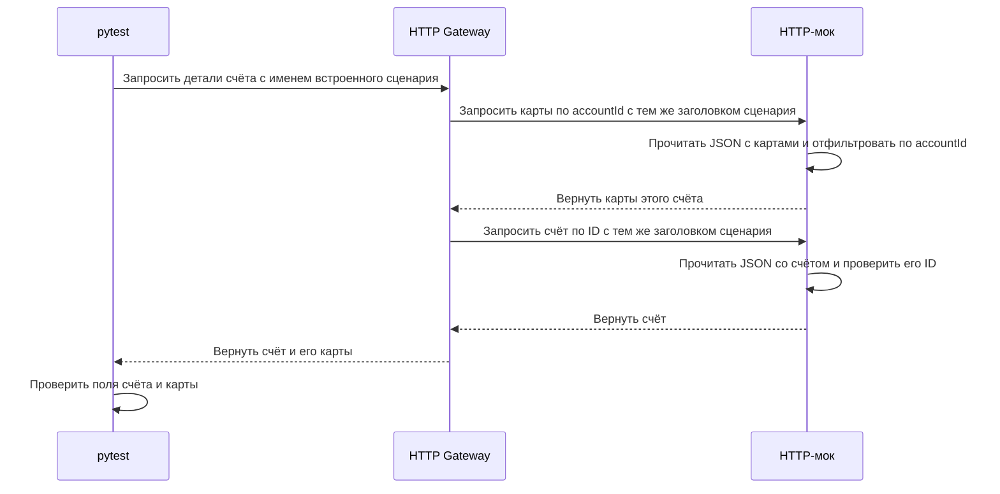
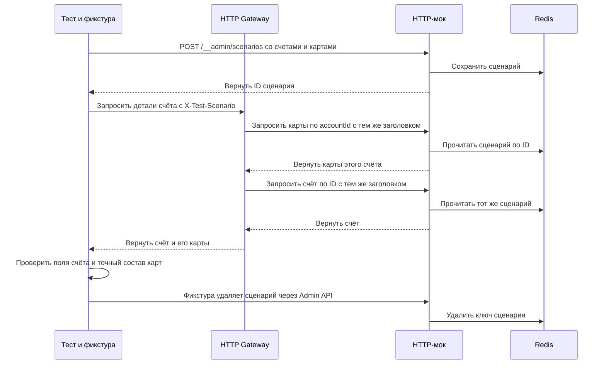
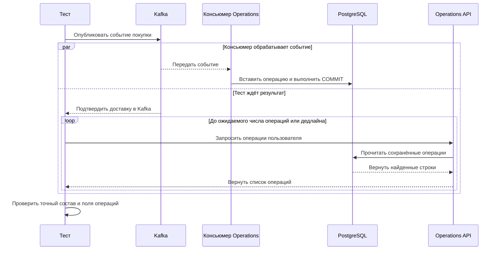

# Isolation API Tests

[English](README.md) · **Русский**

[](https://github.com/Barbaron86/isolation-api-tests/actions/workflows/isolation-tests.yml)


Автотесты API учебной банковской системы. Тесты проверяют **Gateway** с
управляемыми моками Users, Accounts и Cards, а **Operations** — с настоящими
PostgreSQL и Kafka. Сервисы поднимаются в Docker Compose. pytest запускается
на хосте, а шаги, проверки и логи собираются в Allure.

[Отчёт Allure](https://barbaron86.github.io/isolation-api-tests/) ·
[GitHub Actions](https://github.com/Barbaron86/isolation-api-tests/actions/workflows/isolation-tests.yml)

## 📑 Содержание

[Быстрый старт](#-быстрый-старт) · [Технологии](#-технологии) ·
[Тестовые сценарии](#-тестовые-сценарии) · [Архитектура](#-архитектура) ·
[Структура проекта](#-структура-проекта) · [Запуск тестов](#-запуск-тестов) ·
[Отчёты](#-отчёты) · [CI/CD](#-cicd)

## 🚀 Быстрый старт

Установите **Python 3.12** и запустите **Docker с Compose v2** в режиме
Linux-контейнеров. Клонируйте репозиторий и выполняйте команды из его корня.

```shell
git clone https://github.com/Barbaron86/isolation-api-tests.git
cd isolation-api-tests
```

<details>
<summary>Создать виртуальное окружение Python 3.12</summary>

Windows PowerShell:

```powershell
py -3.12 -m venv .venv
.\.venv\Scripts\Activate.ps1
```

Linux или macOS:

```bash
python3.12 -m venv .venv
source .venv/bin/activate
```

</details>

```shell
python -m pip install -r requirements.txt
docker build -t base-service .
docker compose -f docker-compose.yaml up -d
python scripts/wait_for_stand.py --compose-file docker-compose.yaml --timeout 180
python -m pytest -m regression
```

Настройки локального стенда лежат в `.env`, настройки тестовых клиентов — в
`tests/.env`. Скрипт готовности проверяет инициализацию и миграции PostgreSQL,
Redis, брокер и консьюмер Kafka, а также доступность HTTP/gRPC. Остановить стенд
можно командой `docker compose -f docker-compose.yaml down`.

| Компонент | Локальный адрес |
| --- | --- |
| Gateway | HTTP `localhost:8001` · gRPC `localhost:9001` |
| Operations | HTTP `localhost:8002` · gRPC `localhost:9002` |
| Mock Service | [Swagger UI для HTTP](http://127.0.0.1:8003/docs) · gRPC `localhost:9003` |
| Инструменты стенда | [Kafka UI](http://localhost:8081) · [pgAdmin](http://localhost:5050) |

## 🧰 Технологии

| Инструмент | Назначение в проекте |
| --- | --- |
| **Python 3.12** | Язык сервисов, моков и тестового фреймворка. |
| **pytest / pytest-xdist** | Фикстуры, параметризация, выбор тестов по маркерам и параллельный запуск. |
| **HTTPX** | HTTP-клиенты тестов и вызовы зависимостей между сервисами. |
| **gRPC / Protocol Buffers** | Типизированные RPC-контракты, сгенерированные стабы и метаданные запросов. |
| **Pydantic / Pydantic Settings** | Модели запросов и ответов, алиасы полей API и настройки из переменных окружения. |
| **Faker / UUID4** | Синтетические данные и идентификаторы для независимых ресурсов тестов. |
| **FastAPI / Uvicorn** | HTTP API приложений и мок-сервиса. |
| **PostgreSQL / SQLAlchemy / Alembic** | Хранение операций, подготовка и очистка данных тестов, миграции БД. |
| **Kafka / confluent-kafka / aiokafka** | Брокер событий, тестовый продюсер и консьюмер Operations. |
| **Redis / redis-py** | Общее хранилище сценариев HTTP- и gRPC-моков с ограниченным сроком жизни. |
| **Python logging** | Логи вызовов HTTP/gRPC, проверок и очистки. |
| **Allure / allure-pytest** | Шаги тестов, логи, сведения об окружении и история прогонов. |
| **Docker Compose** | Локальный и CI-стенды с проверками готовности. |
| **GitHub Actions / GitHub Pages** | Отдельный запуск unit- и API-тестов и публикация отчёта Allure. |

Версии Python-зависимостей закреплены в [requirements.txt](requirements.txt).
Образы и настройки сервисов описаны в [локальном Compose](docker-compose.yaml)
и [Compose для CI](docker-compose.ci.yaml).

## 🧪 Тестовые сценарии

| Набор | Подготовка данных | Что проверяют тесты |
| --- | --- | --- |
| Gateway HTTP и gRPC | Встроенные сценарии моков | Детали пользователя и счёта, точный состав счетов и карт, пустые списки, отсутствие сущностей и передачу ошибок зависимостей. |
| Динамический Gateway HTTP | Записи теста, зарегистрированные через Admin API мока | Агрегаты пользователя и счёта, состав счетов и карт запрошенной сущности, отсутствие счёта при подготовленных картах. |
| Динамический Gateway gRPC | Тот же Admin API и хранилище Redis | Агрегаты пользователя и счёта, состав счетов и карт запрошенной сущности, передачу `NOT_FOUND` от Accounts при отсутствии счёта. |
| Operations HTTP и gRPC | Строки, вставленные через тестовый репозиторий | Поиск по ID, отсутствие операции, фильтры по пользователю, карте и счёту, совместный фильтр по карте и счёту и точный состав выдачи. |
| Operations через Kafka | События, опубликованные тестом в топик Operations | Обработку покупок в статусах `IN_PROGRESS` и `COMPLETED`, несколько событий одного пользователя и фильтрацию после обработки всех подготовленных событий. |
| Unit-тесты | Подменённые зависимости внутри процесса pytest | Порядок очистки и обработку её ошибок, бюджет запросов репозитория, выбор и хранение сценариев, сериализацию, параметры TTL и ошибки Redis. |
| Интеграционные тесты мока | Изолированный мок с хранилищем сценариев в памяти | Жизненный цикл Admin API, изоляцию сценариев и ответы HTTP- и gRPC-ручек самого мока. |

## 🏗 Архитектура

На картинках показаны границы сервисов. На тестовом стенде клиенты зависимостей
Gateway обращаются напрямую к ручкам HTTP- или gRPC-мока. В обоих наборах
Operations есть сценарии с прямой подготовкой данных в PostgreSQL и сценарии
с обработкой событий Kafka.


<details>
<summary>Архитектура Gateway</summary>


</details>

<details>
<summary>Архитектура Operations</summary>


</details>

### Как работают тесты

Фикстуры pytest готовят данные и предоставляют типизированные клиенты. В
успешных HTTP-сценариях клиент проверяет ожидаемый статус, затем разбирает ответ
через Pydantic. В негативных сценариях тест использует сырой ответ и проверяет
статус и причину ошибки. Для gRPC используются сгенерированные protobuf-стабы.
Доменные ассерты сравнивают ответ с ожиданиями, построенными из данных теста.

#### Gateway и его зависимости

Встроенный сценарий выбирается заголовком `X-Test-Scenario` в HTTP или метаданными
`x-test-scenario` в gRPC. Для динамических HTTP-тестов в тот же заголовок передаётся
ID, полученный от Admin API. Ручка мока выбирает сценарий, затем ищет сущность
или фильтрует данные по идентификатору из запроса.

**Статический `GetAccountDetails`**



Тест передаёт сценарий `USER_WITH_ACTIVE_DEBIT_CARD_ACCOUNT` и получает ID
запрошенного счёта из фикстуры. Мок выбирает JSON-файл для каждой операции.
[Статический тест Gateway](tests/suites/http/test_gateway.py#L143)

**Динамический `GetAccountDetails`**



Тест деталей счёта регистрирует карты двух счетов, затем вызывает Gateway
и проверяет запрошенный счёт и точный состав его карт.
[Тест Gateway](tests/suites/http/test_gateway.py#L367)

`X-Test-Scenario` выбирает набор данных. ID счёта выбирает счёт и его карты
внутри этого набора.

В gRPC-варианте тест регистрирует данные через тот же HTTP Admin API и передаёт
полученный ID в metadata `x-test-scenario`. gRPC-мок читает тот же ключ Redis
для `GetUser`, `GetAccounts`, `GetCards` и `GetAccount` и возвращает
protobuf-сообщения. `GetCard` использует встроенные сценарии. Для динамических
RPC удалённый или просроченный ID даёт `NOT_FOUND`, а ошибка соединения или
таймаут Redis возвращаются как `UNAVAILABLE`.

#### Operations с PostgreSQL или Kafka



После подтверждения доставки в Kafka тест начинает читать HTTP- или gRPC API.
Консьюмер сохраняет операцию независимо от теста. Повторное чтение выполняется,
только если успешный ответ содержит меньше операций, чем ожидалось. Лишние
операции сразу приводят к падению. Если ожидаемое число не появилось до
дедлайна, тест завершается с `TimeoutError`.

**Прямая подготовка через БД** · Тестовый репозиторий вставляет строки в PostgreSQL.
Затем тест один раз вызывает Operations API и проверяет ответ.

Тест фильтрации по карте публикует два события для одного пользователя, ждёт
появления обеих операций, затем фильтрует по карте и проверяет, что в ответе
осталась только нужная операция. [Тест Operations](tests/suites/http/test_operations.py#L288)

Очистка удаляет строки теста по первичным ключам. Для Kafka-событий она до
публикации запоминает существующие ID, а затем ищет новые ID по тройке
`(user_id, card_id, account_id)` текущего теста. Записи, появившиеся после
дедлайна очистки, могут потребовать ручной проверки.

## 📁 Структура проекта

```text
services/           Gateway и Operations, клиенты и контракты зависимостей
libs/               Общие клиенты приложений, контекст и конфигурация
protos/             Protobuf-контракты и сгенерированный код gRPC
tests/
  suites/           API-тесты HTTP и gRPC
  unit/             Unit-тесты очистки, сценариев мока и Redis
  integration/mock/ Прямые интеграционные тесты HTTP- и gRPC-мока
  clients/          Тестовые клиенты HTTP, gRPC, Kafka и PostgreSQL
  fixtures/         Подготовка данных и очистка ресурсов
  schema/           Тестовые модели Pydantic
  assertions/       Протокольные и доменные проверки
  mock/             HTTP- и gRPC-моки и данные сценариев
scripts/            Готовность стенда, диагностика и метаданные Allure
```

## ▶️ Запуск тестов

Для API-тестов Gateway и Operations нужен готовый стенд. Unit-тесты и прямые
интеграционные тесты мока запускаются без Docker и готового стенда.

| Что запустить | Команда |
| --- | --- |
| Unit-тесты | `python -m pytest tests/unit --noconftest -o addopts= -q` |
| Интеграционные тесты мока | `python -m pytest tests/integration/mock -o addopts= -q` |
| Полный API-регресс | `python -m pytest -m regression` |
| Gateway по HTTP и gRPC | `python -m pytest -m gateway` |
| Динамические HTTP-тесты Gateway | `python -m pytest tests/suites/http/test_gateway.py::TestDynamicGatewayHTTP` |
| Динамические gRPC-тесты Gateway | `python -m pytest tests/suites/grpc/test_gateway.py::TestDynamicGatewayGRPC` |
| Operations по HTTP и gRPC | `python -m pytest -m operations` |
| Kafka-сценарии Operations | `python -m pytest -m operations -k operation_events` |

<details>
<summary>Параллельный запуск, отладка и таймауты</summary>

По умолчанию тесты выполняются последовательно. Для API-регресса с двумя
воркерами pytest подготовьте стенд один раз и запустите команду.

```shell
python -m pytest -m regression -n 2 -o addopts= -q --alluredir=./allure-results-parallel
```

Используйте разные ID пользователей в независимых тестах Operations. При
фильтрации только по пользователю API может вернуть все его операции.

Чтобы сохранить данные Operations после падения подготовки или самого теста,
добавьте `--keep-test-data-on-failure`. Во вложении **Cleanup skipped** указаны
зарегистрированные действия и ID теста. Фактическое наличие строк можно
проверить в PostgreSQL и удалить их после отладки. Динамические сценарии Gateway
очищаются своей фикстурой.

| Настройка | Значение по умолчанию | Назначение |
| --- | --- | --- |
| `KAFKA_DELIVERY_TIMEOUT` | `10s` | Подтверждение доставки брокеру. |
| `OPERATIONS_PROCESSING_TIMEOUT` | `10s` | Ожидание результата через API и ограничение поиска строк при очистке одного владельца. |
| `OPERATIONS_POLL_INTERVAL` | `0.25s` | Интервал между чтениями неполного результата. |

Значения можно переопределить через окружение или `tests/.env`. У сетевых фаз
есть отдельные ограничения транспорта. Дедлайн ожидания определяет, до какого
момента принимается результат и запускаются повторные чтения.

</details>

## 📊 Отчёты

### Allure

В [опубликованном отчёте](https://barbaron86.github.io/isolation-api-tests/)
доступны результаты API-тестов, шаги, логи, сведения об окружении и история
прогонов.

Для локального просмотра отчёта нужен [Allure Commandline](https://allurereport.org/docs/v2/install/).

```
python -m pytest -m regression --alluredir=./allure-results
allure serve ./allure-results
```

## 🔄 CI/CD

[Workflow Isolation Tests](.github/workflows/isolation-tests.yml) запускается
при push в `main` и для pull request в `main`.

| Задача | Что делает |
| --- | --- |
| `unit-tests` | Устанавливает зависимости и отдельно запускает unit-тесты. |
| `run-tests` | Собирает образ, поднимает стенд Compose, проверяет готовность и выполняет API-регресс со сбором результатов Allure. |
| `publish-report` | Генерирует API-отчёт с историей и публикует его на [GitHub Pages](https://barbaron86.github.io/isolation-api-tests/). |

Задача API-регресса также сохраняет отдельный артефакт `stand-diagnostics`
с состоянием Compose и результатом сбора диагностики.
